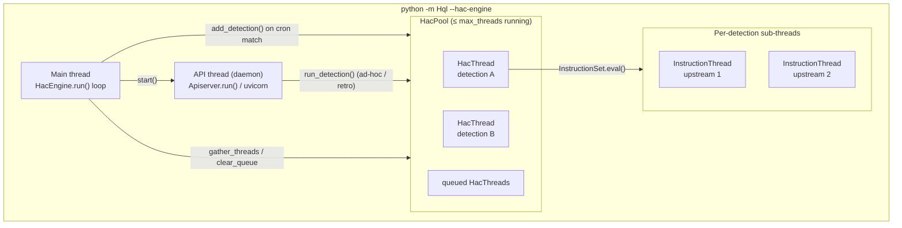
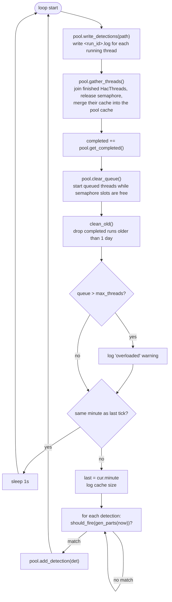
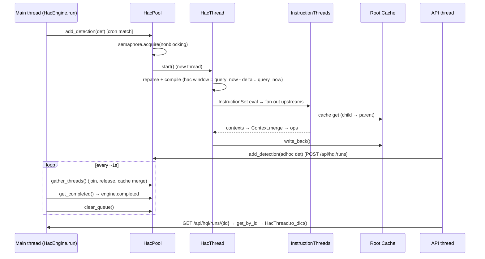

# HaC Engine: Execution Chain and Threading Design

The HaC (Hunt-as-Code) engine is the long-running scheduler that loads
detections from disk, fires them on their cron schedule, and exposes them over
an HTTP API for the Hql-Interface frontend.

Source files:

| File | Role |
| ---- | ---- |
| `Hql/__main__.py` | CLI entrypoint (`--hac-engine`) |
| `Hql/Hac/Engine.py` | `HacEngine` (main loop), `Detection`, `Schedule` (cron) |
| `Hql/Hac/__init__.py` | `Hac`, the parsed metadata block (title, schedule, ...) |
| `Hql/Hac/Parser.py` | Parses the `/** @tag ... */` HaC comment |
| `Hql/Threading.py` | `HacPool`/`HacThread`, `InstructionPool`/`InstructionThread` |
| `Hql/Apiserver/__init__.py` | FastAPI/uvicorn API server |
| `Hql/Cache/Cache.py` | Hierarchical, lock-protected result cache |

## Threads at a glance



| Thread | Created by | Lifetime | Count |
| ------ | ---------- | -------- | ----- |
| Main | the interpreter | the whole process | 1 |
| API server | `Apiserver.start()` | the whole process (`daemon=True`) | 0 or 1 |
| `HacThread` | `HacPool.add_detection()` / `clear_queue()` | one detection run | ≤ `engine.max_threads` (default 16) running at once, the rest queued |
| `InstructionThread` | `InstructionSet.eval()` via `InstructionPool` | one upstream branch of a compiled query | one per upstream, only when there are 2 or more |

All threading depends on `Hql.Helpers.can_thread()`, which is true only on
free-threaded CPython (`3.14t` with the GIL disabled, see
[FREE-THREADING.md](../FREE-THREADING.md)). On a GIL build:

- the API server is **not** started (`HacEngine.apiserver = None`), and
- `HacThread.start()` / `InstructionThread.start()` call `run()` synchronously
  on the calling thread, so detections run one after another on the main
  thread and block the scheduler loop while they run.

## 1. Startup

```text
Hql/__main__.py main()
└─ HacEngine(path, directory, conf_path)
   ├─ scan_files()      rglob *.hql and *.yml (or the single --file)
   ├─ load_conf()       Config(conf_path)
   ├─ load_files()      Detection(txt, src, config) per file → detections{id: Detection}
   ├─ Apiserver(self)   only if can_thread()
   └─ HacPool(max_threads = config.engine.max_threads | 16)
└─ engine.run()         never returns
```

### Building a `Detection`

`Detection.__init__` calls `reparse()` → `gen_hac()`, which tries each format in
turn:

1. **Sigma**: `SigmaParser(txt).gen_hac()`. If it works, `detection.sigma = True`
   and the Sigma parser is kept as `detection.parser`.
2. **HaC comment**: `Hac.Parser.parse_text()` pulls the first `/** ... */`
   block, splits it into `@tag` text/list values, and builds a `Hac`.
   `Hac.validate()` fills in defaults for `schedule` (`0 * * * *`), `author` and
   `id`, and raises if `title`, `status` or `description` is missing.
3. Neither works: `hac = None` and `detection.parser = Hql.Parser(txt)`.

If a `Hac` was found, `detection.id = hac.id` and
`detection.schedule = Schedule(hac.schedule)`. A detection without HaC never
fires on a schedule (`should_fire()` returns `False`), but the API can still run
it ad hoc.

## 2. Main thread: the scheduler loop

`HacEngine.run()` runs this forever:



Points to note:

- **Tick rate.** Housekeeping runs about once a second. Scheduling runs once per
  wall-clock minute, on the first tick after the minute changes. On startup the
  current minute counts as new, so a detection whose schedule matches it fires
  straight away.
- **Time zone.** `cur` is `datetime.now(tz=self.tz)`. `tz` defaults to `None`
  (local time) and the CLI doesn't expose it.
- **Non-blocking dispatch.** `add_detection()` never blocks. A run either takes
  a semaphore slot and starts, or goes on `HacPool.queue`.
- **Ownership.** Only the main thread changes `pool.pool`, `pool.queue` and
  `engine.completed` (apart from API-triggered `add_detection`, see section 4).

### Cron matching (`Schedule`)

`Schedule.parse_cron()` turns each of the 5 fields into a set of allowed
integers (supports `*`, `a-b`, `a,b`, `*/n`, `a/n`, `a-b/n`, and weekday names
`sun`..`sat`). `should_fire()` checks
`(minute, hour, month, day, weekday)` from `gen_parts()` for membership in each
set.

`Schedule.delta()` measures the gap between two consecutive fire times. It
starts at "now", steps forward to the next match, then steps back to the
previous one. The result is the detection's lookback window (see section 3).

## 3. Sub thread: `HacThread`, one detection run

```text
HacPool.add_detection(detection, query_now=None)
└─ HacThread(detection, query_now or now(), ctx = pool.ctx.fork())
   └─ start()  → threading.Thread(name=detection.id, target=run)
      └─ run()
         ├─ Detection.run(query_now, ctx)
         │  ├─ compile(query_now)
         │  │  ├─ reparse()                      fresh parse every run
         │  │  ├─ parser.assemble()              → Query AST
         │  │  ├─ hac = deepcopy(self.hac)
         │  │  │  hac.set_query_now(query_now)   end = query_now, start = end - Schedule.delta()
         │  │  └─ HqlCompiler(config, query, hac)
         │  ├─ compiler.run(ctx)
         │  │  ├─ ctx.hac = hac                  time range is visible to operators/databases
         │  │  └─ root InstructionSet.eval(ctx)  ← may fan out into InstructionThreads
         │  └─ add_run({id, duration, results})  keeps the last 10 runs in detection.run_history
         ├─ output = ctx.data; num_results; completed = True
         ├─ except: log critical + traceback, failed = True
         └─ finally: ctx.cache.write_back()      child cache → pool cache
```

Every run reparses and recompiles from `detection.txt`, so threads share no
AST or compiler state. The `Hac` is deep-copied so each run gets its own
`start`/`end`.

`HacThread.id` is a random 8-hex-digit run id, separate from the detection id.
The API uses it to look up results. When a thread finishes, the main thread's
`gather_threads()` moves it to `HacPool.completed` (at most 1000 kept), and the
next loop iteration moves it to `HacEngine.completed`. `clean_old()` removes it
there once it is more than a day old.

### Concurrency limit

`HacPool.semaphore = Semaphore(max_threads)` caps how many detections run at
once:

- `add_detection()` and `clear_queue()` call `acquire(blocking=False)` and
  start the thread on success, or queue it on failure.
- `gather_threads()` calls `release()` for each thread it joins (or fails to
  join).

Queued threads start in FIFO order, but only when the main thread runs
`clear_queue()`, so a free slot is picked up within about a second.

## 4. Sub-sub threads: `InstructionThread`, upstream fan-out

A compiled query is a tree of `InstructionSet`s. Each set has `upstream`
children (database fetches or other instruction sets) and a list of `ops`.
`InstructionSet.eval()`:

```text
InstructionSet.eval(ctx)
├─ pool = InstructionPool(auto_run=False)
├─ for each upstream: pool.add_instruction(upstream, ctx.copy())
├─ pool.start()
│  ├─ 1 upstream  → run inline on the current thread (no thread is created)
│  └─ N upstreams → one threading.Thread per upstream, target = upstream.eval(ctx)
├─ poll every 100 ms: pool.get_completed() until the pool is idle
├─ any output is None → CompilerException
├─ Context.merge(outputs, merge_rows=False)
└─ run self.ops sequentially on the merged context
```

This recurses: an upstream that is itself an `InstructionSet` can start its
own `InstructionPool`. A single `HacThread` can therefore produce a tree of
short-lived threads, one per branch (for example a `union`, or a
product/category source that resolves to several backends). The pool
semaphore does **not** limit these threads; only the top-level `HacThread`s
are bounded.

`ctx.copy()` deep-copies the symbol table, databases, functions, config and
HaC for each branch, but **shares** `data` and `cache`. So all instruction
threads of one detection read and write the same child cache.

## 5. Sub thread: API server

`Apiserver.start()` runs `uvicorn.run(app, host='0.0.0.0', port=8080)` on a
daemon thread. uvicorn's event loop and FastAPI's threadpool for sync
endpoints run on that thread and its workers. The handlers hold a reference
to the `HacEngine` and act on it directly:

| Endpoint | Effect on engine state |
| -------- | ---------------------- |
| `GET /api/detections[/{id}[/history]]` | reads `engine.detections` |
| `POST /api/detections` | `write_detection()` to disk, then **replaces** `engine.files` and `engine.detections` with a fresh `load_files()` |
| `POST /api/hql/runs` (submit) | `run_detection(Detection(..., no_hac=True))` → `pool.add_detection()` |
| `POST /api/detections/retro` | steps from `start` to `end` in `Schedule.delta()` increments and calls `run_detection(det, query_now=t)` at each step |
| `GET /api/hql/runs`, `/api/hql/runs/{tid}` | `engine.get_runs()` / `get_by_id()` read `engine.completed` and `pool.pool/queue/completed` |

So `HacPool.add_detection()` is called from both the main thread (scheduled
runs) and API worker threads (ad hoc and retro runs). The semaphore makes
the start-or-queue decision safe, but the `pool`/`queue` lists are ordinary
Python lists with no extra lock.

## 6. Cache hierarchy

```text
HacPool.ctx.cache            root Cache (parent=None), lives as long as the engine
├─ HacThread A ctx.cache     Cache(parent=root), from Context.fork()
│  └─ shared by every InstructionThread of A (Context.copy() keeps the cache)
└─ HacThread B ctx.cache     Cache(parent=root)
```

- **Reads** (`Cache.get`) check the local table under its lock, then fall
  back to the parent. A parent hit is copied into the child and marked dirty.
- **Write-back** (`Cache.write_back`) merges child into parent. It is called
  in `InstructionThread.run()`'s `finally`, in `HacThread.run()`'s `finally`,
  and again by the main thread in `HacPool.gather_threads()`
  (`pool.ctx.cache.merge(t.ctx.cache)`).
- Every `Cache` has its own `threading.Lock`. `Cache.__deepcopy__` returns
  `self`, so deep-copying a context never duplicates a cache.

Because the root cache outlives individual runs, a detection that fires every
minute with an overlapping time range can reuse fetches from earlier runs and
from other detections that query the same source.

## 7. End-to-end sequence



## Known caveats

These match the current code and are listed so readers don't rely on them:

- **Cron field order.** `parse_cron()` reads fields 3 and 4 as
  *month, day-of-month*, the reverse of standard cron
  (*day-of-month, month*). `gen_parts()` uses the same order, so the engine is
  self-consistent, but a standard `0 0 1 * *` means "January, every day" here.
- **Weekday numbering.** `gen_parts()` uses `datetime.weekday()` (Mon=0), while
  `parse_cron()` maps names with `sun=0`. Weekday names and numbers are off
  by one compared with cron.
- **List mutation while iterating.** `HacPool.gather_threads()`,
  `HacPool.clear_queue()`, `HacEngine.clean_old()` and
  `InstructionPool.get_completed()` remove items from the list they are
  looping over, so some items are skipped until the next pass. In the engine
  this only delays cleanup by a tick. `InstructionPool` polls until idle, so
  the result is still correct.
- **Unsynchronised shared state.** `pool.pool`, `pool.queue`,
  `engine.detections` and `Detection.run_history` can be changed from both
  the main thread and API or worker threads without a lock.
- **`write_detections()`** writes `<run_id>.log` files for running threads
  into the detection directory (or next to the single file) on every tick.
